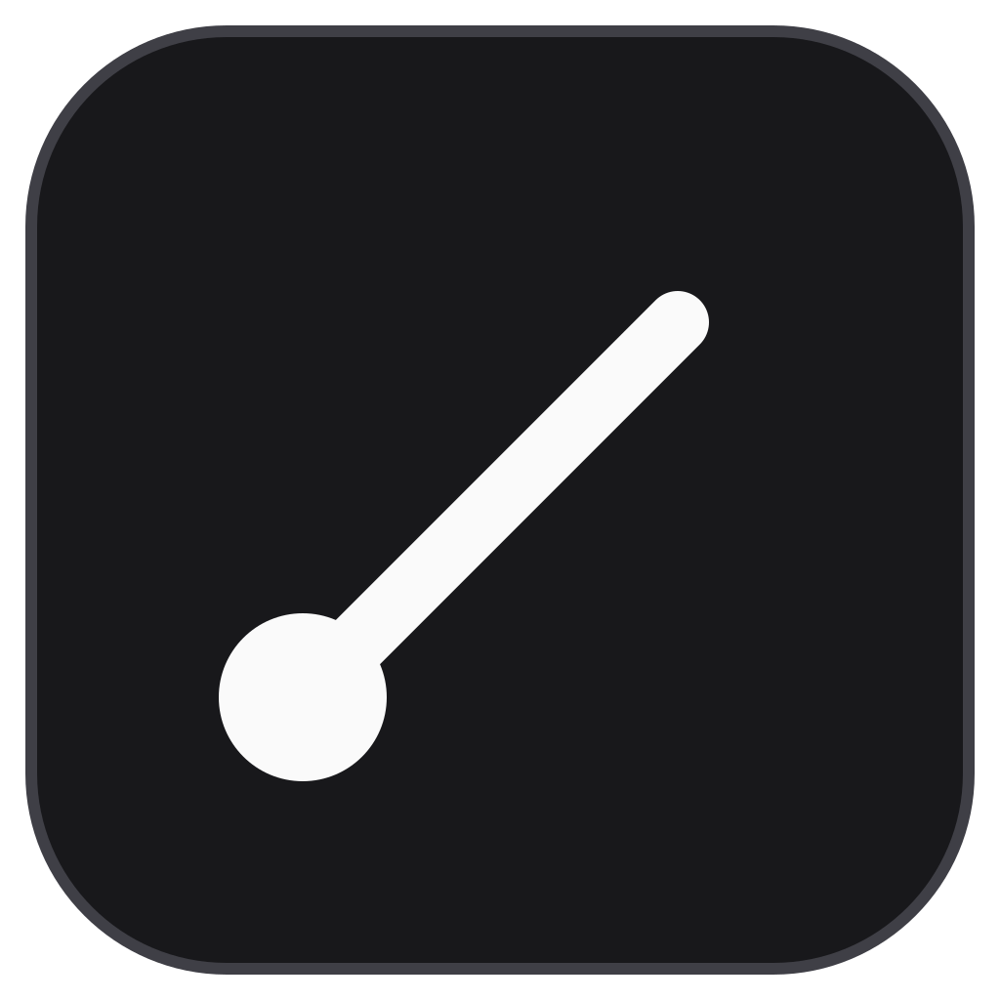

<h1 align="center">Baguette</h1>

<b>Le pilote automatique de Claude Code : le prix avant, la preuve après, dans ta langue.</b>

<a href="README.md">English</a> · <a href="docs/benchmark.md">Benchmark</a> · <a href="CONTRIBUTING.md">Contribuer</a>

---

Baguette est une app de bureau (Windows, Linux) qui pilote le Claude Code officiel pour toi. Tu décris ce que tu veux avec tes mots. Baguette pose les quelques questions qui comptent, affiche le coût **avant** que quoi que ce soit démarre, laisse Claude Code travailler dans ton plafond, puis **prouve** le résultat : tests, fichiers, captures sur ordinateur et téléphone, et un relecteur indépendant.

**Accès anticipé : tout est gratuit.** Pas de compte, pas de carte, rien ne nous est envoyé.

## Ce que fait l'app

| | |
|---|---|
| **Questions** | Seulement celles qui changent le résultat, jamais deux fois dans le même projet. |
| **Brief** | Tes mots deviennent un brief précis, avec des critères de réussite vérifiables. |
| **Devis et plafond** | Coût probable en euros (clé API) ou en % de ta fenêtre d'utilisation (abonnement). La tâche s'arrête à ton plafond. |
| **Exécution** | Le CLI `claude` officiel, non modifié, avec le bon modèle, le bon effort et des garde-fous. Les actions irréversibles (push, mise en ligne, suppression en masse) sont bloquées sauf si tu les autorises. |
| **Preuve** | Chaque critère vérifié : commandes, fichiers, captures (ordinateur et téléphone), relecteur en lecture seule. Les échecs peuvent être retentés dans la même session. |
| **Pilote de nuit** | Des tâches préparées tournent la nuit. Si ton quota est épuisé, il attend sa remise à zéro et continue. Rapport au réveil. |
| **Mode freelance** | Prix client sur chaque devis, relevé d'activité mensuel avec la preuve de chaque tâche. |
| **Sécurité** | Timeline avec retour en arrière en un clic, garde-fou contre les fuites de clés et de données perso, antivirus des skills, docteur des connecteurs. |
| **Partage** | Un GIF animé de la tâche : demande, devis, rendu ordinateur et téléphone, preuve. |

Interface en 10 langues, modes Débutant et Expert.

## Connexion à Claude

- **Ton abonnement Claude** : tu te connectes avec `claude auth login`, le parcours officiel de Claude Code. Baguette ne lit, ne stocke et ne transmet jamais tes identifiants.
- **Une clé API** : rangée dans le trousseau du système, transmise uniquement au processus Claude Code.

Ton code et tes demandes restent entre toi et Anthropic : Baguette tourne sur ton ordinateur et n'a aucun serveur pendant l'accès anticipé.

Baguette est un projet indépendant, **sans lien avec Anthropic**. Claude et Claude Code sont des marques d'Anthropic, PBC.

## Installer

Télécharge l'installateur de ton système dans la [dernière version](../../releases/latest). L'app se met à jour toute seule (mises à jour signées).

Windows peut afficher un avertissement SmartScreen, car l'installateur n'est pas encore signé : clique sur **Informations complémentaires → Exécuter quand même**.

## Licence

[Functional Source License 1.1 (FSL-1.1-ALv2)](LICENSE.md) : tu peux lire, utiliser, modifier et redistribuer le code, y compris au travail, sauf pour proposer un produit concurrent. Chaque version passe sous licence Apache-2.0 deux ans après sa sortie.
